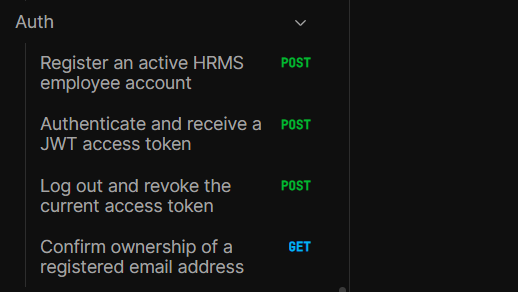
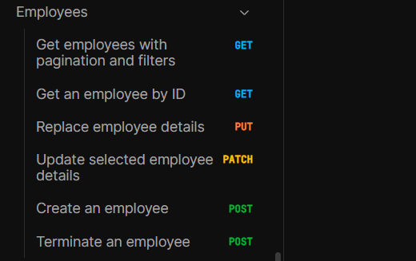
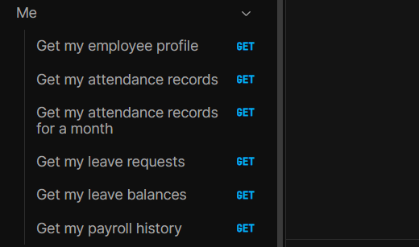
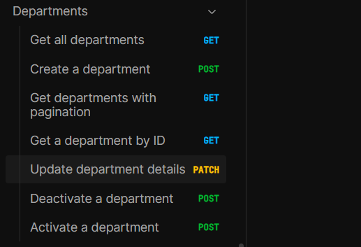
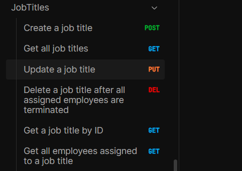
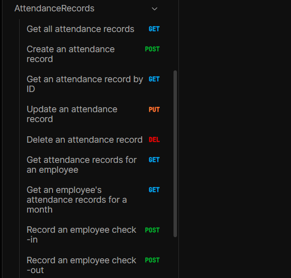
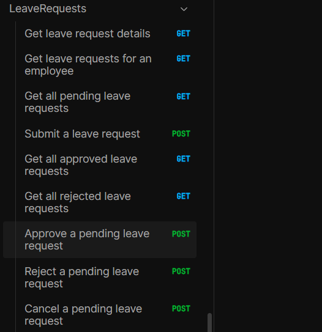
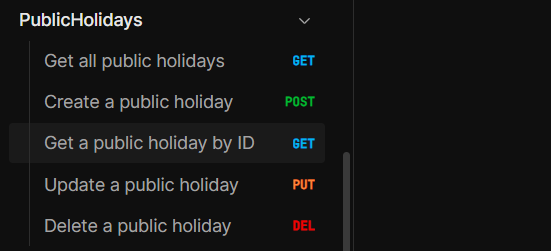
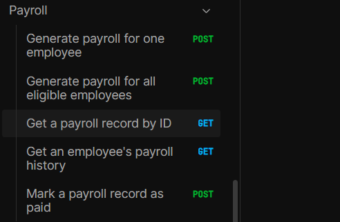
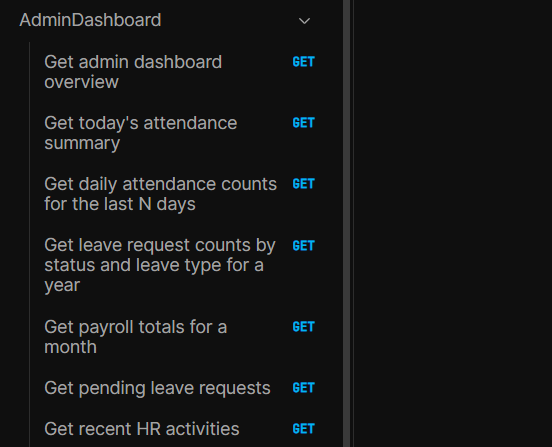

# HRMS

A Human Resource Management System REST API built with ASP.NET Core, following a layered (Clean Architecture) design.


## Table of Contents

- [Overview](#overview)
- [Key Features](#key-features)
- [Tech Stack](#tech-stack)
- [Architecture](#architecture)
- [Project Structure](#project-structure)
- [Database Design](#database-design)
- [Business Rules & Workflows](#business-rules--workflows)
- [Authentication & Authorization](#authentication--authorization)
- [API Endpoints](#api-endpoints)
- [Getting Started](#getting-started)
- [Configuration](#configuration)
- [Roadmap](#roadmap)
- [Documentation](#documentation)
- [License](#license)

## Overview

HRMS manages the employee lifecycle: organizational structure, attendance, leave, public holidays and monthly payroll, with role-based access control and an admin dashboard.

## Key Features

- **Employees:** create, update (PUT/PATCH), terminate (with type and reason), delete, and a paged listing with search and filters (department, status, name / phone / email)
- **Organization:** departments (paged listing, activate/deactivate, manager assignment) and job titles
- **Attendance:** check-in before 09:00 is Present, 09:00 through 12:00 is Late, later check-ins are rejected; plus manual records for HR
- **Leave management:** submit, approve, reject (with reason) and cancel requests, with per-year leave balances
- **Public holidays:** full CRUD
- **Payroll:** per-employee or whole-month generation with absence, late and unpaid-leave deductions; mark as paid
- **Admin dashboard:** overview, today's attendance, attendance trend, pending leaves, leave summary, payroll summary and recent activities
- **Security:** ASP.NET Core Identity, JWT bearer tokens, logout with access-token revocation, email confirmation, account lockout and four roles

## Tech Stack

| Area | Technology |
|---|---|
| Framework | ASP.NET Core Web API, .NET 10 (C#) |
| Database | SQL Server via Entity Framework Core 10 (code-first migrations) |
| Authentication | ASP.NET Core Identity + JWT Bearer |
| CQRS / mediator | MediatR, with a FluentValidation pipeline behavior |
| Validation | FluentValidation |
| Mapping | AutoMapper |
| Caching | In-memory cache, invalidated by an EF Core interceptor when reference data changes |
| Email | SMTP (email confirmation) |
| API docs | OpenAPI + Scalar API Reference (Development environment) |

## Architecture

Four projects in `HRMS.slnx`, with dependencies pointing inward:

```
HRMS.Api  ──►  HRMS.Application  ──►  HRMS.Domain
    │                 ▲
    └─►  HRMS.Infrastructure  (implements Application abstractions)
```

- **Domain:** entities with behavior (e.g. `LeaveRequest.Approve`, `Employee.Terminate`, `AttendanceRecord.CheckInAt`), enums and constants
- **Application:** MediatR commands and queries per feature, validators, DTOs, mapping profiles, repository and service interfaces. Handlers return a `Result<T>` with typed errors (NotFound, Conflict, Validation, Forbidden, Unauthorized)
- **Infrastructure:** `AppDbContext`, EF configurations and migrations, repositories, Identity/JWT/SMTP services, data seeders
- **Api:** controllers, route constants (`Router.cs`), request models, response wrapping and global exception handling

## Project Structure

```
HRMS/
├── HRMS.Api/              # Controllers, Routers, Requests, Models, ResponseHandling, Exceptions, Program.cs
├── HRMS.Application/      # Features (per use case), Validators, Dtos, Mapping, Behaviors, Repositories
├── HRMS.Domain/           # Entities, Enums, Constants
├── HRMS.Infrastructure/   # Data (DbContext, Configurations, Migrations, Seed), Identity, Repositories, Caching, Attendance
├── docs/                  # Current system documentation (PDF)
└── HRMS.slnx
```

## Database Design

**Entities:** `Employee`, `Department`, `JobTitle`, `LeaveType`, `LeaveBalance`, `LeaveRequest`, `AttendanceRecord`, `PublicHoliday`, `Payroll`, `RevokedAccessToken`, plus the ASP.NET Identity tables. `ApplicationUser.EmployeeId` links a login to an employee record.

| Relationship | Description |
|---|---|
| Employee → Department | many-to-one (`DepartmentId`) |
| Employee → JobTitle | many-to-one (`JobTitleId`) |
| Employee → Employee | self-reference (`ManagerId` / `Subordinates`) |
| Department → Employee | optional department manager (`ManagerId`) |
| Employee → LeaveRequest | requester (`EmployeeId`) and optional reviewer (`ReviewedById`) |
| LeaveRequest → LeaveType | many-to-one |
| Employee + LeaveType → LeaveBalance | balance per employee, leave type and year (`TotalDays`, `UsedDays`) |
| Employee → AttendanceRecord | one-to-many |
| Employee → Payroll | one-to-many (per month and year) |

**Enums**

| Enum | Values |
|---|---|
| `EmploymentStatus` | Active, OnLeave, Terminated |
| `TerminationType` | Resignation, Dismissal, EndOfContract, Retirement |
| `LeaveStatus` | Pending, Approved, Rejected, Cancelled |
| `AttendanceStatus` | Present, Late, Absent, OnLeave |
| `PayrollStatus` | Unpaid, Paid |

## Business Rules & Workflows

### Attendance
- Status is derived from check-in time: before 09:00 is **Present**, from 09:00 through 12:00 is **Late**, and after 12:00 check-in is rejected as Absent.
- Check-in is rejected if the employee already checked in today, or if today's record is already marked Absent or OnLeave.
- Check-out requires a prior check-in, cannot be earlier than the check-in, and can happen only once.
- Concurrent updates to the same attendance record are detected, and the request fails with a conflict instead of overwriting the other change.
- Manual records (Admin/HR) must have consistent punches, and the status must match the check-in time. Existing punches cannot be removed on update.

### Leave
1. **Submit:** rejected if the employee already has a pending or approved request overlapping the dates, if the date range is invalid, or if the balance for any affected year is missing or insufficient. Otherwise the request is created as `Pending`.
2. **Approve** (Admin, HR, Manager): only pending requests. Balances are re-checked, then days are deducted from the balance of each year the leave spans. Days are counted as calendar days per year.
3. **Reject** (Admin, HR, Manager): only pending requests; a rejection reason is stored.
4. **Cancel:** only pending requests.

### Employees & organization
- Terminating an already-terminated employee is rejected; termination stores type, reason and date.
- A department cannot be deactivated while it has active employees.
- A job title cannot be deleted while non-terminated employees are assigned to it.

### Payroll
- Requires `Payroll:WorkingDaysPerMonth` (1–31).
- `Daily salary = BaseSalary / WorkingDaysPerMonth`
- Absence deduction = absent days × daily salary (absent days that fall inside unpaid leave are not double-counted)
- Late deduction = late days × 300 (fixed in code)
- Unpaid-leave deduction = unpaid leave days within the month × daily salary
- `Net salary = Base − absence − late − unpaid leave`
- A payroll record starts as `Unpaid` and can be marked as paid once.

## Authentication & Authorization

- **Registration** (`POST /api/v1/auth/register`) is only allowed for an **Active** employee whose email matches an existing employee record, and only once per employee. The new account gets the `Employee` role and must confirm its email before logging in. If the confirmation email cannot be sent, the account is rolled back.
- **Login** returns a JWT (issuer, audience and lifetime from `JwtSettings`). Terminated or inactive employees cannot log in.
- **Logout** (`POST /api/v1/auth/logout`) revokes the current access token.
- **Password policy:** minimum 8 characters, with upper-case, lower-case, digit and non-alphanumeric characters.
- **Lockout:** 5 failed attempts lock the account for 15 minutes.
- **Roles:** `Admin`, `HR`, `Manager`, `Employee`. The roles and a default Admin user are created at startup from configuration.

| Area | Admin | HR | Manager | Employee |
|---|:-:|:-:|:-:|:-:|
| Employees, departments, job titles, payroll | ✅ | ✅ | – | – |
| Admin dashboard | ✅ | – | – | – |
| Attendance: view | ✅ | ✅ | ✅ | – |
| Attendance: check-in / check-out | ✅ | ✅ | ✅ | ✅ |
| Attendance: create / update / delete | ✅ | ✅ | – | – |
| Public holidays: view | ✅ | ✅ | ✅ | ✅ |
| Public holidays: create / update / delete | ✅ | ✅ | – | – |
| Leave: view | ✅ | ✅ | ✅ | – |
| Leave: submit / cancel | ✅ | ✅ | ✅ | ✅ |
| Leave: approve / reject | ✅ | ✅ | ✅ | – |

## API Endpoints

Base path: `/api/v1`, including the admin dashboard at `/api/v1/admin/dashboard`. All endpoints except `register`, `login` and `confirm-email` require a bearer token.

### Auth

<details>
<summary>View Auth endpoints screenshot</summary>


</details>

| Method | Route | Access | Description |
|---|---|---|---|
| POST | `/auth/register` | Anonymous | Register an employee account |
| POST | `/auth/login` | Anonymous | Authenticate and receive a JWT |
| POST | `/auth/logout` | Authenticated | Revoke the current access token |
| GET | `/auth/confirm-email` | Anonymous | Confirm email (`userId`, `token`) |

### Employees (Admin, HR)

<details>
<summary>View Employees endpoints screenshot</summary>


</details>

| Method | Route | Description |
|---|---|---|
| GET | `/employees/paged` | Paged list with filters (department, status, search) |
| GET | `/employees/{id}` | Get by ID |
| PUT | `/employees/{id}` | Replace employee details |
| PATCH | `/employees/{id}` | Update selected employee details |
| POST | `/employees` | Create an employee |
| POST | `/employees/{id}/terminate` | Terminate an employee |

### Employee self-service (Employee)

These routes derive the employee ID from the authenticated user's JWT; clients do not send an employee ID.

<details>
<summary>View Employee Self-Service endpoints screenshot</summary>


</details>

| Method | Route | Description |
|---|---|---|
| GET | `/me/profile` | Get my employee profile |
| GET | `/me/attendance` | Get my attendance records |
| GET | `/me/attendance/monthly?year=2026&month=11` | Get my attendance records for a month |
| GET | `/me/leave-requests` | Get my leave requests |
| GET | `/me/leave-balances` | Get my leave balances by leave type and year |
| GET | `/me/payroll` | Get my payroll history |

### Departments (Admin, HR)

<details>
<summary>View Departments endpoints screenshot</summary>


</details>

| Method | Route | Description |
|---|---|---|
| GET | `/departments` | List |
| GET | `/departments/paged` | Paged list |
| GET | `/departments/{id}` | Get by ID |
| POST | `/departments` | Create |
| PATCH | `/departments/{id}` | Update selected details |
| POST | `/departments/{id}/activate` | Activate |
| POST | `/departments/{id}/deactivate` | Deactivate |

### Job titles (Admin, HR)

<details>
<summary>View Job Titles endpoints screenshot</summary>


</details>

| Method | Route | Description |
|---|---|---|
| GET | `/job-titles` | List |
| GET | `/job-titles/{id}` | Get by ID |
| GET | `/job-titles/{id}/employees` | Employees assigned to the title |
| POST | `/job-titles` | Create |
| PUT | `/job-titles/{id}` | Update |
| DELETE | `/job-titles/{id}` | Delete (after assigned employees are terminated) |

### Attendance records

<details>
<summary>View Attendance Records endpoints screenshot</summary>


</details>

| Method | Route | Roles | Description |
|---|---|---|---|
| GET | `/attendance-records` | Admin, HR, Manager | Get all attendance records |
| GET | `/attendance-records/{id}` | Admin, HR, Manager | Get an attendance record by ID |
| GET | `/attendance-records/employee/{employeeId}` | Admin, HR, Manager | Get attendance records for an employee |
| GET | `/attendance-records/employee/{employeeId}/monthly` | Admin, HR, Manager | Get an employee's monthly records (`year`, `month`) |
| POST | `/attendance-records/check-in` | All roles | Record an employee check-in |
| POST | `/attendance-records/check-out` | All roles | Record an employee check-out |
| POST | `/attendance-records` | Admin, HR | Create |
| PUT | `/attendance-records/{id}` | Admin, HR | Update |
| DELETE | `/attendance-records/{id}` | Admin, HR | Delete |

### Leave requests

<details>
<summary>View Leave Requests endpoints screenshot</summary>


</details>

| Method | Route | Roles | Description |
|---|---|---|---|
| GET | `/leave-requests` | Admin, HR, Manager | Get all pending leave requests |
| GET | `/leave-requests/approved` | Admin, HR, Manager | Get all approved leave requests |
| GET | `/leave-requests/rejected` | Admin, HR, Manager | Get all rejected leave requests |
| GET | `/leave-requests/employee/{employeeId}` | Admin, HR, Manager | Get leave requests for an employee |
| GET | `/leave-requests/{id}` | Admin, HR, Manager | Get leave request details |
| POST | `/leave-requests` | All roles | Submit a leave request |
| POST | `/leave-requests/{id}/cancel` | All roles | Cancel a pending leave request |
| POST | `/leave-requests/{id}/approve` | Admin, HR, Manager | Approve a pending leave request |
| POST | `/leave-requests/{id}/reject` | Admin, HR, Manager | Reject a pending leave request |

### Public holidays

<details>
<summary>View Public Holidays endpoints screenshot</summary>


</details>

| Method | Route | Roles | Description |
|---|---|---|---|
| GET | `/public-holidays` | All | List |
| GET | `/public-holidays/{id}` | All | Get by ID |
| POST | `/public-holidays` | Admin, HR | Create |
| PUT | `/public-holidays/{id}` | Admin, HR | Update |
| DELETE | `/public-holidays/{id}` | Admin, HR | Delete |

### Payroll (Admin, HR)

<details>
<summary>View Payroll endpoints screenshot</summary>


</details>

| Method | Route | Description |
|---|---|---|
| POST | `/payroll/generate` | Generate for one employee (`employeeId`, `month`, `year`) |
| POST | `/payroll/generate-monthly` | Generate for a month (`month`, `year`) |
| GET | `/payroll/{id}` | Get by ID |
| GET | `/payroll/employee/{employeeId}` | Employee payroll history |
| POST | `/payroll/{id}/paid` | Mark as paid |

### Admin dashboard (Admin)

<details>
<summary>View Admin Dashboard endpoints screenshot</summary>


</details>

| Method | Route | Description |
|---|---|---|
| GET | `/api/v1/admin/dashboard/overview` | Overview |
| GET | `/api/v1/admin/dashboard/attendance` | Today's attendance summary |
| GET | `/api/v1/admin/dashboard/attendance/trend?days=30` | Daily attendance counts for the last N days |
| GET | `/api/v1/admin/dashboard/leave/summary?year=2026` | Leave request counts by status and leave type for a year |
| GET | `/api/v1/admin/dashboard/payroll/summary?month=11&year=2026` | Payroll totals for a month |
| GET | `/api/v1/admin/dashboard/pending-leaves` | Pending leave requests |
| GET | `/api/v1/admin/dashboard/recent-activities` | Recent HR activities |

In the **Development** environment the app exposes an OpenAPI document and the Scalar API Reference UI.

## Getting Started

### Prerequisites

- [.NET 10 SDK](https://dotnet.microsoft.com/download)
- SQL Server instance
- SMTP account (for email confirmation)

### Setup

```bash
git clone https://github.com/Ahm3dHegazy/HRMS.git
cd HRMS/HRMS.Api

# Store secrets outside source control
dotnet user-secrets set "ConnectionStrings:DefaultConnection" "<your-connection-string>"
dotnet user-secrets set "JwtSettings:SecretKey" "<at-least-32-bytes-secret>"
dotnet user-secrets set "AdminUser:Email" "admin@example.com"
dotnet user-secrets set "AdminUser:Password" "<strong-password>"
dotnet user-secrets set "Payroll:WorkingDaysPerMonth" "22"
dotnet user-secrets set "Email:Smtp:Host" "<smtp-host>"
dotnet user-secrets set "Email:Smtp:From" "<from-address>"
dotnet user-secrets set "Email:Smtp:Username" "<smtp-user>"
dotnet user-secrets set "Email:Smtp:Password" "<smtp-password>"

dotnet run
```

On startup the application:

1. Requires the database schema to be up to date with EF Core migrations (`dotnet ef database update`).
2. Seeds sample data **only if the database has no employees** (departments, job titles, leave types, employees, leave balances, attendance records, leave requests and public holidays).
3. Creates the four roles and the default Admin user from `AdminUser:*` (startup fails if `AdminUser:Email` or the initial password is missing).

Then open the Scalar API Reference (Development environment), log in with the Admin account, and use the returned JWT as a bearer token to try the endpoints.

## Configuration

Configured in `HRMS.Api/appsettings.json`, user secrets or environment variables (use `__` as the separator, e.g. `JwtSettings__SecretKey`).

| Key | Purpose | Default in `appsettings.json` |
|---|---|---|
| `ConnectionStrings:DefaultConnection` | SQL Server connection string | local `SQL2025` instance, Windows auth |
| `JwtSettings:Issuer` / `Audience` | Token issuer and audience (required) | `HRMS` / `HRMS-Clients` |
| `JwtSettings:SecretKey` | Signing key, **at least 32 UTF-8 bytes** (required) | empty |
| `JwtSettings:AccessTokenMinutes` | Token lifetime in minutes | `30` |
| `AdminUser:Email` / `Password` | Default Admin account (required) | empty |
| `Attendance:TimeZoneId` | Time zone used for attendance | `Egypt Standard Time` |
| `Payroll:WorkingDaysPerMonth` | Divisor for daily salary (1–31, required to generate payroll) | `null` |
| `Email:Smtp:Host` / `Port` / `EnableSsl` / `From` / `Username` / `Password` | SMTP settings | port `587`, SSL on |
| `Email:ConfirmationUrl` | Base URL used in confirmation emails | `https://localhost:7121/api/v1/auth/confirm-email` |

> Never commit real secrets. Use user secrets or environment variables for sensitive values.

## Roadmap

- Add employee self-service attendance and leave reads with ownership checks based on the authenticated employee
- Block check-in on approved leave days and public holidays
- Pagination and filtering for all list endpoints (attendance, leave requests, payroll history)
- Unit tests for the domain rules (attendance, leave, payroll) and integration tests for the API
- Docker support and a CI pipeline

## Documentation

The current system documentation is [`HRMS – System Documentation.pdf`](<docs/HRMS – System Documentation.pdf>).

## License

This project is licensed under the [MIT License](LICENSE).
