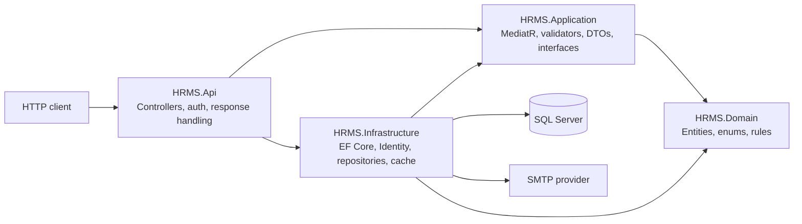
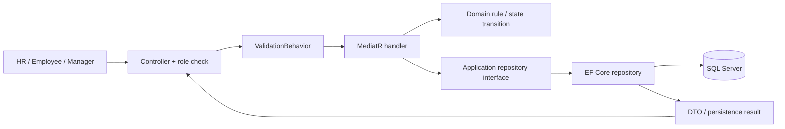
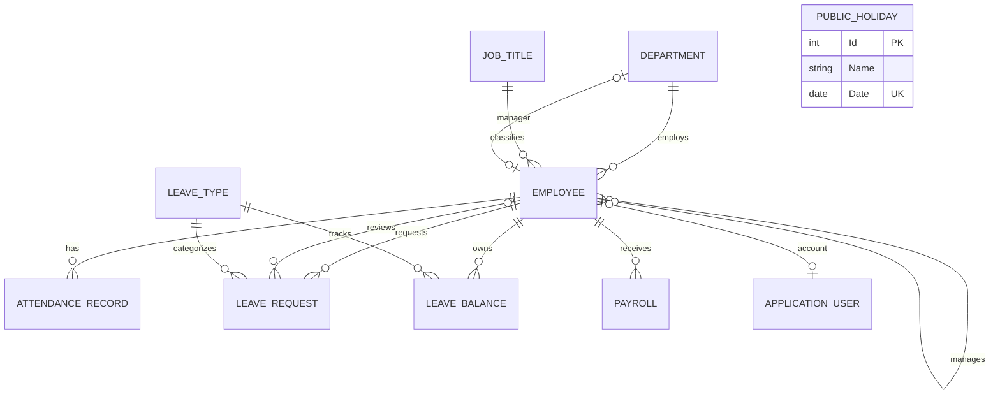

# HRMS - Complete System Analysis & Documentation

**Report date:** 19 November 2026  
**Repository reviewed:** `C:\Users\abdel\source\repos\HRMS`  
**Scope:** Read-only analysis of the code currently present. This report documents implemented behavior, not an intended product specification.

> “Implemented” means a request can be traced through an API/entry point, Application handler and persistence path. “Partial” means some pieces exist but the full workflow is missing. “Not implemented” means no executable path was found. Rules absent from code are marked as undefined rather than assumed.

## Contents

1. [Executive Summary](#1-executive-summary)
2. [Project Architecture](#2-project-architecture)
3. [Complete Features Inventory](#3-complete-features-inventory)
4. [Business Rules Catalog](#4-business-rules-catalog)
5. [End-to-End Workflows](#5-end-to-end-workflows)
6. [Entity Relationships & Database Design](#6-entity-relationships--database-design)
7. [API Reference](#7-api-reference)
8. [Authentication & Authorization](#8-authentication--authorization)
9. [Architecture & Code Quality Review](#9-architecture--code-quality-review)
10. [Missing Features & Business Rule Gaps](#10-missing-features--business-rule-gaps)
11. [Recommendations & Suggested Improvements](#11-recommendations--suggested-improvements)
12. [Evidence and Source Map](#12-evidence-and-source-map)

---

## 1. Executive Summary

HRMS is a .NET 10 ASP.NET Core Web API organized into `HRMS.Api`, `HRMS.Application`, `HRMS.Domain`, and `HRMS.Infrastructure`. Implemented areas include identity registration/login/email confirmation, employee and department administration, job titles, attendance, leave requests and balances, public holidays, an admin dashboard, and payroll. MediatR dispatches requests to Application handlers; Infrastructure uses EF Core with SQL Server and ASP.NET Core Identity.

The system has substantial core workflows, but several boundaries are incomplete. Employee callers can supply arbitrary employee IDs to attendance and leave endpoints; handlers do not consistently bind those IDs to the authenticated user. Some routes are declared as constants without an action (employee delete and logout). Leave types and balances have entities/repositories but no API maintenance endpoints. Payroll generation depends on an unset `Payroll:WorkingDaysPerMonth` setting and deliberately has no built-in workweek/holiday formula.

The code contains Domain attendance checks, unique indexes, validation, a configured local clock, and conditional updates that prevent concurrent punches overwriting each other. Other rules are validator-only, race-prone, or differ between EF configuration and migration operations. The initial migration has no table check constraints; the payroll migration adds checks only for Payrolls.

Architecturally, the solution follows recognizable Clean Architecture dependency direction with CQRS/MediatR and repositories. The highest risks are object-level authorization, absent JWT revocation, concurrency around leave balances/overlaps, missing payroll workday configuration, and EF model/database migration drift.

## 2. Project Architecture

### 2.1 Projects and responsibilities

| Project | Responsibility | Evidence |
|---|---|---|
| `HRMS.Api` | Controllers/routes, HTTP request models, JWT setup, response envelope, exception handling, OpenAPI/Scalar in Development, startup/seeding. | `HRMS.Api/Program.cs`, `Controllers/`, `Requests/`, `Routers/Router.cs`, `ResponseHandling/`, `Exceptions/` |
| `HRMS.Application` | MediatR commands, queries and handlers; repository/service interfaces; DTOs; FluentValidation and pipeline behavior; mapping. | `HRMS.Application/Features/`, `Repositories/`, `Validators/`, `Behaviors/ValidationBehavior.cs` |
| `HRMS.Domain` | Persisted business entities, enums, entity methods and shared length constants. | `HRMS.Domain/Entities/`, `Enums/`, `Constants/` |
| `HRMS.Infrastructure` | EF `AppDbContext`, configurations/migrations, SQL Server repositories, cache, Identity/JWT, SMTP, seeding and DI registration. | `HRMS.Infrastructure/Data/`, `Repositories/`, `Identity/`, `Caching/`, `DependencyInjection.cs` |

`HRMS.slnx` lists these four projects. A separate `HRMS.Tests` directory is present, but it is not listed in the inspected solution file; invoke it directly unless the solution is updated.

### 2.2 Architecture diagram

Application references Domain. Infrastructure implements Application interfaces and references Domain. API composes the layers and references Infrastructure for startup. Domain has no dependency on Application or Infrastructure.

### 2.3 Request flow

1. ASP.NET Core routes a request to a controller; `ApiControllerBase` supplies `[ApiController]` and `[Authorize]` defaults.
2. The action builds a MediatR command/query, sometimes mapping an API request with AutoMapper.
3. MediatR’s `ValidationBehavior<TRequest,TResponse>` executes every registered FluentValidation validator and throws `ValidationException` on failure.
4. `ApiExceptionHandler` maps validation failures to 400, or 409 when an error code is `Conflict`; unhandled exceptions are logged and returned as a generic 500 envelope.
5. The handler orchestrates work through `HRMS.Application.Repositories` or `IAuthService`.
6. Infrastructure queries/persists through EF Core/Identity and projects reads to DTOs.
7. `HandleResult` maps `Result<T>` to response envelopes/status codes. Some actions construct envelopes directly.

### 2.4 Technologies and persistence

- .NET 10 / ASP.NET Core; MediatR 14.3.0; FluentValidation 12.2.0; AutoMapper 16.3.0.
- EF Core SQL Server 10.0.15 and ASP.NET Core Identity EF stores 10.0.15; JWT bearer and `System.IdentityModel.Tokens.Jwt` 8.22.0.
- OpenAPI 10.0.14 and Scalar 2.19.0; SMTP uses `System.Net.Mail.SmtpClient`.
- No Redis, message broker, background worker, frontend, or payment provider was found.

`AppDbContext` derives from `IdentityDbContext<ApplicationUser>` and applies configurations in the Infrastructure assembly. The configured connection is local SQL Server `.#SQL2025` / database `HRMSDb` with Integrated Security and `TrustServerCertificate=TRUE` (actual string uses `Server=.\SQL2025`).

At startup, `HrmsSeedData.InitializeAsync` calls `Database.MigrateAsync()` and seeds sample organization, leave types, employees, balances, attendance, leave requests and 2026 holidays only if no employees exist. Then `IdentitySeeder` creates roles and requires `AdminUser:Email`; when creating a new Admin it also requires `AdminUser:Password`. Current checked-in values are blank, so secrets/configuration are required for startup.

Tracked migrations: `20261116145020_Initial` and `20261119200648_AddPayroll`. The Payroll migration creates Payrolls and its index/check constraints. EF configuration declares additional checks for older tables that are absent from inspected migration operations; see Sections 6 and 10.

## 3. Complete Features Inventory

### 3.1 Authentication and authorization - implemented, lifecycle gaps

Registration requires an existing Active employee whose normalized email matches. It creates a linked Identity user, assigns `Employee`, sends confirmation mail and deletes the new account if role assignment or mail delivery fails. Email confirmation validates a Base64Url-wrapped Identity token. Login requires confirmed email, validates password with lockout, rejects non-Active linked employees and returns a signed JWT. Roles seeded: Admin, HR, Manager, Employee. Logout, refresh-token and token-revocation flows are absent; `LogoutUser` exists only as a route constant.

### 3.2 Employee management - implemented, deletion absent

Create, list, details, paged/filter read, update, patch and terminate are implemented. Creation validates unique email/phone/national ID, department/job title and active manager, salary over 10,000 and hire date today through 30 days ahead; handler sets Active through `Hire()`. Termination records type/reason/date and rejects repeated or future termination. `DeleteEmployee` has no controller action.

### 3.3 Department management - implemented

Create/list/details/patch/activate/deactivate exist. Deactivation fails while active employees remain. Names are checked for case-insensitive duplicates and have a unique index. Optional manager must be Active. The code does not require a manager to belong to that department. No department delete; Router’s department update constant has no PUT action.

### 3.4 Job-title management - implemented

Create/update/list/get/list employees/delete exist. Delete is blocked while assigned employees are not Terminated. Names are unique.

### 3.5 Attendance - implemented

List/get/employee history/month history/manual create/update/delete/check-in/check-out exist. Punch routes take EmployeeId and get local time from an injected clock. Defaults are work start 08:30, cutoff 12:00, grace 15 minutes, timezone `Egypt Standard Time`. At/before 08:45 is Present; after 08:45 through 12:00 is Late; after cutoff check-in is rejected. Punch endpoints require Active employees. Employee/date has a unique index; conditional database updates avoid concurrent punch overwrite. Attendance does not automatically create daily Absent/OnLeave rows.

### 3.6 Leave requests and balances - request workflow implemented; setup incomplete

Create/get by ID/get by employee/list Pending/Approved/Rejected/approve/reject/cancel exist. Date ranges are inclusive, future and ordered; overlap with Pending/Approved requests is checked; yearly balance is checked at submission and approval. Approval deducts UsedDays and sets Approved/ReviewedAt. Rejection requires a reason; only Pending requests can be approved/rejected/cancelled.

LeaveType has `IsPaid` and `RequiresApproval`; the current workflow does not branch on `RequiresApproval`, and approval deducts leave balance for every type regardless of `IsPaid`. Type/balance entities and repositories exist but no management API was found. Reviewer ID is modeled but not set by approval.

### 3.7 Public holidays - reference-data CRUD implemented

List/get/create/update/delete exist; duplicate dates are rejected and Date is unique. Public holidays are not used by attendance or payroll calculations.

### 3.8 Admin dashboard - implemented read-only summaries

Overview returns employee status counts, department count and pending leave count. Attendance counts persisted records for the configured local date. Recent activity merges up to 10 attendance rows and 10 reviewed leave requests then returns the newest 10. It does not synthesize absences or provide payroll metrics.

### 3.9 Payroll - implemented, requires configuration

Single employee/month/year generation, monthly generation, get by ID, employee history and Mark Paid exist. The current `Payroll:WorkingDaysPerMonth` is null, so generation returns validation failure until configured 1-31. Formula uses BaseSalary, attendance and approved unpaid leave; deduplicates unpaid dates and excludes overlapping absent days from absence deductions. Paid leave is excluded. Each Late row deducts 300; no holiday/weekend calculation, proration, tax, benefit, overtime or payment-provider logic exists. Payrolls are unique per employee/month/year; monthly generation skips existing rows and returns all records for the period.

### 3.10 Not found in this repository

No recruitment/applicant tracking, performance reviews, training, benefits, expenses, shift scheduling, biometric integration, payroll export/payment, role administration, LeaveType/LeaveBalance API, password reset, resend confirmation or logout action was found.

## 4. Business Rules Catalog

### 4.1 Employee and organization rules

| Rule | Exact behavior and enforcement |
|---|---|
| Employee fields | Required text, email and phone formats/lengths; NationalId exactly 14 digits. FluentValidation; errors flow through the validation pipeline. |
| Identity uniqueness | Email, phone and NationalId prechecked in business validators and protected by unique indexes. A concurrent duplicate can still fail in SQL. |
| Salary | Strictly `BaseSalary > 10000`; application validators and EF check config. Existing migrations do not create that check. |
| Hire date | New employee must be between `DateTime.Today` and today + 30 days. Business validator only; seed inserts bypass it. |
| Initial status | Create handler calls `Employee.Hire()`, setting Active. |
| Manager | Must exist and be Active; employee cannot manage self on update/patch. No database rule prevents longer manager cycles. |
| Termination | Enum type valid, reason required, date required and not future; already Terminated is a conflict. Validator and `Employee.Terminate()`. |
| Department deactivation | Domain refuses when any Active employees exist; handler returns Conflict. |
| Job title deletion | Domain permits only when all assigned employees are Terminated; handler returns Conflict otherwise. |

Employment enum values: Active=1, OnLeave=2, Terminated=3. Department/job title names have unique indexes. Manager’s department membership is not constrained.

### 4.2 Attendance rules

- Punch endpoints reject missing employees (404) and non-Active employees (409).
- Policy defaults: 08:30 start, 12:00 cutoff, 15-minute grace, Egypt Standard Time. `Present` through 08:45 inclusive; `Late` after 08:45 through 12:00 inclusive; check-in after 12:00 is rejected.
- One record per EmployeeId/local Date is enforced by a unique index. Check-in only when no prior CheckIn; check-out requires CheckIn, is not earlier, and is recorded once. Atomic conditional updates protect existing-row punches against concurrent requests.
- Manual create/update consistency: Present/Late require CheckIn; Absent/OnLeave have no punches; CheckOut requires CheckIn and must be >= it; punch status must match configured policy.
- Update refuses changing/removing existing punch values. Other fields such as employee/date can still be changed if validation and uniqueness pass.
- Automatic daily absence creation is not implemented. Cutoff does not schedule a background process.

### 4.3 Leave and balance rules

- Start/end required, future, ordered. Day count is inclusive calendar days and split by calendar year.
- Any overlapping Pending or Approved request blocks creation. Rejected/Cancelled do not. There is no DB constraint preventing concurrent overlap races.
- Every affected year must have a balance for employee/type; `AvailableDays = TotalDays - UsedDays` must cover the requested days.
- Approval only from Pending; checks balance again, calls `TryDeduct` per year, changes status and stores UTC review time, then performs one `SaveChangesAsync`. No explicit application transaction or row version protects simultaneous approvals.
- Rejection only Pending and requires a reason. Cancellation only Pending. There is no reversal/refund path after approval.
- `RequiresApproval` is not consulted: submission always becomes Pending. `IsPaid` does not affect leave balance deduction during approval.
- Leave request does not validate that employee is currently Active or that request EmployeeId matches authenticated caller.

### 4.4 Payroll rules

| Component | Code behavior |
|---|---|
| Daily salary | `BaseSalary / Payroll:WorkingDaysPerMonth`; required setting 1..31. No default in appsettings. |
| Absence | Count unique Absent dates not overlapping approved unpaid leave; multiply by daily salary; round 2 decimals, midpoint away from zero. |
| Late | Count Late attendance rows × 300 EGP. |
| Unpaid leave | Unique inclusive dates from approved unpaid leave overlapping the month × daily salary; round 2 decimals. |
| Paid leave | Not selected by payroll query, so no deduction. |
| Net | Base salary minus absence, late and unpaid leave deductions; not clamped at zero. |
| Eligibility | Not Terminated and hired on/before month-end. Termination date is not used for historical eligibility/proration. |
| Status | New row Unpaid; conditional update marks Unpaid -> Paid and stores UTC PaidAt. |
| Duplicate | Unique EmployeeId/Year/Month. Single generation conflicts; batch skips existing rows. |

No code defines working weekdays, holiday exclusions, mid-month proration or salary policy for termination during a period. These must not be inferred from PublicHoliday records.

### 4.5 Identity, authorization and data integrity

- Registration trims/normalizes email, matches an existing Active Employee, prevents a second account for that Employee, creates Identity user, assigns Employee, and requires email confirmation.
- Password: length >=8; digit, uppercase, lowercase, non-alphanumeric; >=1 unique character. Lockout: 5 failed attempts for 15 minutes.
- Confirmation uses an Identity token Base64Url encoded in link. Invalid/expired values return a generic message. Login requires confirmed email and Active linked employee.
- JWT uses HMAC-SHA256, issuer/audience/key/expiration validation; secret >=32 UTF-8 bytes; appsettings expiration=30 minutes; roles use `role` claim.
- No logout/revocation. Controller role attributes do not enforce employee-level row ownership.
- EF configs declare text/date/status/balance check constraints and restrictive FKs, but most checks are missing from migration operations. Unique indexes exist in migration/model for core identity fields and employee-period records.

## 5. End-to-End Workflows

### 5.1 Employee

Admin/HR posts AddEmployeeRequest -> controller maps to command -> MediatR runs format and business validators -> handler maps to Employee, calls `Hire`, adds and saves -> SQL constraints enforce FKs/uniqueness -> 201 response. Update/patch loads tracked Employee, maps changed values and saves; terminate calls Domain `Terminate` and saves. Errors: validation 400, duplicate conflict 409, unknown target 404, repeated termination 409.

### 5.2 Attendance

Authenticated caller posts `{employeeId}` -> handler loads employee and requires Active -> injected clock derives Egypt-local date/time -> repository loads that day -> Domain validates/categorizes -> insert or conditional update -> DTO query -> response. Check-out follows same path and must have prior check-in. Manual HR endpoint uses AttendanceRecordRequest and Domain consistency rules. No automatic absent generation.

### 5.3 Leave

Caller submits employee/type/date range/reason -> validators check shape, future/order, existence -> handler rejects overlapping pending/approved request -> splits inclusive days by year and checks each leave balance -> saves Pending request. Admin/HR/Manager reviews: approve rechecks/deducts yearly balances and saves status/time; reject requires reason; cancel works only while Pending. No reviewer identity is stored by the current command, and no self-ownership enforcement was found.

### 5.4 Payroll

Admin/HR invokes generation -> validator checks ID/month/year -> settings must have WorkingDaysPerMonth 1..31 -> employee eligibility/existing period check -> query period attendance and approved unpaid leave -> calculate and persist Payroll -> DTO response. Monthly generation skips saved periods per employee and returns payroll DTOs for the period. Mark Paid conditionally changes Unpaid to Paid. No funds transfer or recalculation endpoint exists.

### 5.5 Identity

Public register -> match active employee by normalized email -> create linked Identity user -> assign Employee role -> email confirmation token/link via SMTP -> public confirm endpoint validates -> public login checks confirmation/password/lockout/status -> JWT. Email send failure attempts account deletion; failed cleanup is logged. No password reset, resend confirmation or logout workflow exists.

## 6. Entity Relationships & Database Design

### 6.1 Entity inventory

| Entity | Properties/purpose | Relationships |
|---|---|---|
| Employee | Id, FullName, Address, Email, Phone, NationalId, HireDate, BaseSalary, Status, optional termination date/type/reason. | Required Department/JobTitle; optional Employee manager; many attendance, requester/reviewer leave, balances and payrolls; optional Identity account. |
| Department | Id, Name, optional Description, IsActive, optional ManagerId. | One-to-many Employees; optional Employee manager FK. |
| JobTitle | Id, Name, optional Description. | One-to-many Employees. |
| AttendanceRecord | Id, Date, nullable CheckIn/CheckOut, Status, EmployeeId. | Required Employee; unique EmployeeId+Date. |
| LeaveRequest | Id, StartDate, EndDate, Reason, Status, optional ReviewedAt/RejectionReason, EmployeeId, optional ReviewedById, LeaveTypeId. | Required requester Employee and LeaveType; optional reviewer Employee. |
| LeaveType | Id, Name, DefaultDaysPerYear, IsPaid, RequiresApproval. | Many requests and balances. |
| LeaveBalance | Id, Year, TotalDays, UsedDays; AvailableDays computed. | Required Employee and LeaveType; unique employee/type/year. |
| PublicHoliday | Id, Name, Date. | Standalone, unique Date. |
| Payroll | Id, EmployeeId, Month, Year, BaseSalary, three deductions, NetSalary, Status, CreatedAt, nullable PaidAt. | Required Employee; unique employee/year/month. |
| ApplicationUser | ASP.NET Identity fields plus nullable EmployeeId/navigation. | Optional one-to-one Employee. Identity roles/claims/logins/tokens use Identity tables. |

### 6.2 ERD

### 6.3 Keys, constraints and delete behavior

- Business entities use integer identity PKs; Identity uses string IDs.
- Unique indexes: Employee Email/NationalId/Phone; Department.Name; JobTitle.Name; LeaveType.Name; PublicHoliday.Date; attendance `(EmployeeId,Date)`; balance `(EmployeeId,LeaveTypeId,Year)`; payroll `(EmployeeId,Year,Month)`.
- Leave requests also index `(EmployeeId,StartDate,EndDate)` and Status.
- Required FKs: employee->department/job title; attendance->employee; request->requester/leave type; balance->employee/type; payroll->employee. ApplicationUser.Employee is optional one-to-one.
- Most business FK deletes use Restrict. This preserves referenced records and can prevent hard deletes.
- EF configurations define checks for salary, enum/status validity, nonblank data, dates, leave balance bounds and attendance ordering. Migration files inspected do not add these checks for existing tables. Payroll migration does add its own period/amount/status checks.

## 7. API Reference

### 7.1 Conventions

Most routes use `/api/v1`; Dashboard instead uses `/api/admin/dashboard/...` (no `/v1`). Response envelope: `{ success, message, data, errors }`. `HandleResult`: NotFound=404, Conflict=409, Unauthorized=401, Forbidden=403, other application failures=400. Success defaults to 200; some create actions return 201. Validation errors are 400, or 409 for error code `Conflict`; unhandled exceptions are logged and return a generic 500 envelope. `[ApiController]` also returns model-state failures as envelope 400s.

Employee paging only: `pageNumber` default 1, `pageSize` default 10, search text and optional department/status filters. Sort is fixed by Employee.Id ascending; no sort parameter.

### 7.2 Authentication

| Method | Endpoint | Purpose | Authorization | Request | Response |
|---|---|---|---|---|---|
| POST | `/api/v1/auth/register` | Register active employee account. | Anonymous | RegisterDto | 201, user ID string. |
| POST | `/api/v1/auth/login` | Authenticate. | Anonymous | LoginDto (email/password) | 200, JWT string. |
| GET | `/api/v1/auth/confirm-email?userId=...&token=...` | Confirm email. | Anonymous | userId/token query | 200, user ID string. |

`/api/v1/auth/logout` is declared but has no action.

### 7.3 Employees (controller: Admin, HR)

| Method | Endpoint | Purpose | Request | Response |
|---|---|---|---|---|
| GET | `/api/v1/employees` | List all. | None | Employee detail list. |
| GET | `/api/v1/employees/{id}` | Employee detail. | Route id | Employee detail DTO. |
| POST | `/api/v1/employees` | Create. | AddEmployeeRequest | 201 success envelope. |
| PUT | `/api/v1/employees/{id}` | Replace supported details. | UpdateEmployeeRequest | Employee detail DTO. |
| PATCH | `/api/v1/employees/{id}` | Patch fields/clear manager. | PatchEmployeeRequest | Employee detail DTO. |
| POST | `/api/v1/employees/{id}/terminate` | Terminate. | TerminateEmployeeRequest | Terminated employee DTO. |
| GET | `/api/v1/employees/paged` | Paged/filter list. | EmployeeFilter/PaginationParams query | Paged employee details. |

DeleteEmployee has a Router constant but no controller action.

### 7.4 Departments and job titles (both: Admin, HR)

| Method | Endpoint | Purpose | Request/response |
|---|---|---|---|
| GET | `/api/v1/departments` | List departments. | None -> department list. |
| GET | `/api/v1/departments/{id}` | Details. | id -> department details DTO. |
| POST | `/api/v1/departments` | Create. | AddDepartmentRequest -> department DTO (controller returns 200). |
| PATCH | `/api/v1/departments/{id}` | Patch. | PatchDepartmentRequest -> patched DTO. |
| POST | `/api/v1/departments/{id}/deactivate` | Deactivate if no active employees. | id -> null success data. |
| POST | `/api/v1/departments/{id}/activate` | Activate. | id -> null success data. |
| POST | `/api/v1/job-titles` | Create title. | CreateJobTitleRequest -> 201 job-title DTO. |
| PUT | `/api/v1/job-titles/{id}` | Update title. | UpdateJobTitleRequest -> title DTO. |
| DELETE | `/api/v1/job-titles/{id}` | Delete if all assigned employees terminated. | id -> bool. |
| GET | `/api/v1/job-titles` | List. | None -> title list. |
| GET | `/api/v1/job-titles/{id}` | Get. | id -> title DTO. |
| GET | `/api/v1/job-titles/{id}/employees` | Assigned employees. | id -> employee detail list. |

Department Update route constant exists without a PUT action; no department delete exists.

### 7.5 Attendance (controller: Admin, HR, Manager, Employee; manual writes: Admin, HR)

| Method | Endpoint | Purpose | Request -> response |
|---|---|---|---|
| GET | `/api/v1/attendance-records` | List all. | None -> Attendance DTO list. |
| GET | `/api/v1/attendance-records/{id}` | Get one. | id -> Attendance DTO. |
| GET | `/api/v1/attendance-records/employee/{employeeId}` | Employee history. | employeeId -> DTO list. |
| GET | `/api/v1/attendance-records/employee/{employeeId}/monthly?year=&month=` | Month history. | query year/month -> DTO list. |
| POST | `/api/v1/attendance-records` | Manual create. | AttendanceRecordRequest -> 201 DTO. |
| POST | `/api/v1/attendance-records/check-in` | Check in at configured local clock. | AttendancePunchRequest(employeeId) -> DTO. |
| POST | `/api/v1/attendance-records/check-out` | Check out. | AttendancePunchRequest -> DTO. |
| PUT | `/api/v1/attendance-records/{id}` | Manual update. | AttendanceRecordRequest -> DTO. |
| DELETE | `/api/v1/attendance-records/{id}` | Delete. | id -> bool. |

### 7.6 Leave requests and public holidays

Leave controller default roles: Admin, HR, Manager, Employee; approve/reject require Admin/HR/Manager. Public holiday read uses those four roles; writes require Admin/HR.

| Method | Endpoint | Purpose | Request -> response |
|---|---|---|---|
| GET | `/api/v1/leave-requests/{id}` | Get request. | id -> leave DTO. |
| GET | `/api/v1/leave-requests/employee/{employeeId}` | Employee requests. | employeeId -> DTO list. |
| GET | `/api/v1/leave-requests` | Pending requests (action is GetPending). | None -> Pending DTO list. |
| GET | `/api/v1/leave-requests/approved` | Approved. | None -> Approved DTO list. |
| GET | `/api/v1/leave-requests/rejected` | Rejected. | None -> Rejected DTO list. |
| POST | `/api/v1/leave-requests` | Submit. | CreateLeaveRequest -> 201, created ID. |
| POST | `/api/v1/leave-requests/{id}/approve` | Approve/deduct balance. | id -> review result. |
| POST | `/api/v1/leave-requests/{id}/reject` | Reject. | id + rejection reason -> review result. |
| POST | `/api/v1/leave-requests/{id}/cancel` | Cancel Pending. | id -> status string. |
| GET | `/api/v1/public-holidays` | List. | None -> holiday list. |
| GET | `/api/v1/public-holidays/{id}` | Get. | id -> holiday DTO. |
| POST | `/api/v1/public-holidays` | Create. | CreatePublicHolidayRequest -> 201 DTO. |
| PUT | `/api/v1/public-holidays/{id}` | Update. | UpdatePublicHolidayRequest -> DTO. |
| DELETE | `/api/v1/public-holidays/{id}` | Delete. | id -> bool. |

### 7.7 Dashboard and payroll

Dashboard requires Admin; Payroll requires Admin/HR.

| Method | Endpoint | Purpose | Request -> response |
|---|---|---|---|
| GET | `/api/admin/dashboard/overview` | Headcount/department/pending-leave totals. | None -> AdminDashboardDto. |
| GET | `/api/admin/dashboard/attendance` | Today’s persisted attendance counts. | None -> AdminDashboardAttendanceDto. |
| GET | `/api/admin/dashboard/pending-leaves` | Pending leave list. | None -> Pending DTOs. |
| GET | `/api/admin/dashboard/recent-activities` | Recent attendance/review activities. | None -> Activity DTO list. |
| POST | `/api/v1/payroll/generate?employeeId=&month=&year=` | Generate one payroll. | Query params -> 201 PayrollDto. |
| POST | `/api/v1/payroll/generate-monthly?month=&year=` | Generate missing month payroll. | Query params -> PayrollDto list for period. |
| GET | `/api/v1/payroll/{id}` | Read payroll. | id -> PayrollDto. |
| GET | `/api/v1/payroll/employee/{employeeId}` | Payroll history. | employeeId -> PayrollDto list. |
| POST | `/api/v1/payroll/{id}/paid` | Mark Paid. | id -> PayrollDto. |

There are no payroll edit/delete endpoints, role administration, LeaveType/LeaveBalance endpoints, or implemented logout action.

## 8. Authentication & Authorization

ASP.NET Core Identity stores accounts and hashes passwords through its standard password hasher. Registration is employee-linked and requires email confirmation. SMTP/Admin credentials/JWT key are expected from user secrets/environment; checked-in SMTP host/from and admin values are blank.

`JwtTokenService` issues HMAC-SHA256 JWTs with subject, user identifier, email, JTI and role claims. `Program.cs` validates issuer, audience, key and expiry; token lifetime is configured by `AccessTokenMinutes` (30 in current appsettings). No server-side revocation store exists; logout cannot invalidate an issued token.

| Surface | Roles |
|---|---|
| Register/login/confirm | Anonymous |
| Employee/Department/JobTitle controllers | Admin, HR |
| Attendance read and punch | Admin, HR, Manager, Employee |
| Attendance manual create/update/delete | Admin, HR |
| Leave read/create/cancel | Admin, HR, Manager, Employee |
| Leave approve/reject | Admin, HR, Manager |
| Public holiday read | Admin, HR, Manager, Employee |
| Public holiday write | Admin, HR |
| Dashboard | Admin |
| Payroll | Admin, HR |

These are role checks, not object ownership checks. For instance, an Employee can submit another employee’s ID to check-in or query leave by another employee ID; the relevant handlers do not bind the ID to the JWT subject.

## 9. Architecture & Code Quality Review

### 9.1 Strengths

- Clear layer separation and dependency direction for core application/domain logic.
- MediatR handlers keep controller actions relatively thin; common FluentValidation behavior is centralized.
- DTO projections and `AsNoTracking` are used in specialized reads.
- Domain methods encode attendance, leave state, department deactivation, termination and balance rules.
- Reference caching is restricted to Departments, JobTitles, LeaveTypes and PublicHolidays. Cached values are DTOs or ID sets, produced via `GetOrCreateAsync` with 10-minute absolute expiry. A `SaveChangesInterceptor` invalidates after save; Employee and Department changes invalidate department cache.
- Attendance clock has explicit timezone; existing-row punches use conditional SQL updates. Payroll period uniqueness and conditional Paid update also handle duplicates/races.

### 9.2 Weaknesses and tradeoffs

- Some actions bypass `HandleResult`, producing inconsistent success/status handling.
- Validation and handler checks are split; some validators load entire reference lists for a duplicate-name check. This can repeat DB work.
- Generic `GetAllAsync` returns tracked entities and lacks cancellation tokens; feature read methods usually project more carefully.
- Employee/leave/attendance list endpoints are broad for all roles assigned to each controller; no consistent per-employee authorization.
- Leave approval has no balance concurrency token/atomic deduction; overlap precheck has a race window.
- `ReviewedById` exists but approval does not set it. Self-manager check does not prevent longer cycles.
- Startup always applies migrations/seeds and requires Admin configuration. Startup depends on database availability.
- Some validators use machine-local `DateTime.Today`, attendance uses Egypt timezone and audit times use UTC.
- EF model constraints and migration operations have drifted.
- No explicit general transaction orchestration; SaveChanges uses the provider’s ordinary transaction behavior for statements within that save.

### 9.3 DI and support services

Application assembly-scans MediatR handlers, validators and AutoMapper; registers `ValidationBehavior`. Infrastructure registers `AppDbContext`, Identity, auth services, mail, repositories, memory cache, clock, seeder and cache interceptor. Most repositories/services are Scoped; `TimeProvider.System` and `IAttendanceClock` are Singleton. API registers controllers, OpenAPI, ProblemDetails and `ApiExceptionHandler`.

### 9.4 Verification snapshot

In the immediately preceding implementation session, a solution build completed with zero errors; it reported `CS9107` primary-constructor capture warnings in repositories and `NU1900` when NuGet could not reach its vulnerability feed. The standalone test project reported **12 passed, 0 failed**. This documentation task is read-only with respect to application code and does not rerun or modify those projects.

## 10. Missing Features & Business Rule Gaps

| Severity | Finding | Impact/evidence | Recommendation |
|---|---|---|---|
| High - confirmed | Employee object-level authorization absent on attendance/leave. | Arbitrary EmployeeId/record ID can be supplied; role-only guards allow cross-employee reads/actions. | Resolve caller EmployeeId from identity; enforce ownership per self-service operation. |
| High - confirmed | Logout/JWT revocation absent. | Logout route is only a constant; JWT remains valid until expiry, including after termination. | Define revocation/refresh strategy or explicitly constrain use to short-lived access tokens and recheck active state. |
| High - risk | Leave balance approval race. | Concurrent approvals can read same available balance then both deduct. | RowVersion or atomic conditional deduction and conflict response. |
| High - risk | Overlapping leave create race. | Precheck is not backed by a concurrency-safe constraint. | Serialize per employee or use a database-safe overlap strategy. |
| High - confirmed | `RequiresApproval` unused. | All requests become Pending regardless of leave type. | Define and implement behavior or remove unused field. |
| High - confirmed | Payroll configuration absent. | `WorkingDaysPerMonth=null` blocks generation; no workday/holiday rule in code. | Agree on the policy and configure its source before enabling payroll. |
| High - confirmed | Payroll eligibility/proration unclear. | Eligibility includes non-Terminated hires through month-end; termination date and partial-month pay are not used. | Confirm historical and partial-month policy. |
| High - confirmed | EF config checks absent from old migration history. | Salary, attendance, leave and other checks are not created by migration files inspected. | Review and generate a migration after auditing existing data. |
| Medium - confirmed | PublicHolidays not integrated with attendance/payroll. | Holiday records have no consumers in calculation flows. | Decide whether holidays matter before connecting them. |
| Medium - confirmed | No automatic absent records. | Dashboard sees saved rows only; no closeout job. | Add a scheduled process only if automatic absence is a stated requirement. |
| Medium - confirmed | No LeaveType/LeaveBalance API. | Admin cannot configure these models via current HTTP API. | Add authorized management workflow or document seed/database maintenance. |
| Medium - confirmed | Route constants without actions. | Employee delete, department update and logout are declared but not implemented. | Remove stale constants or implement according to retention/security policy. |
| Medium - confirmed | No approved leave balance reversal. | Approved requests cannot be cancelled/refunded. | Define adjustment workflow if corrections are needed. |
| Medium - confirmed | Reviewer not recorded. | Approval command accepts only request ID; ReviewedById remains null. | Persist authenticated reviewer identity. |
| Medium - confirmed | Admin configuration mandatory at startup. | Empty AdminUser settings cause `IdentitySeeder` to throw. | Treat secrets as deployment prerequisites and validate them in deployment docs. |
| Medium - confirmed | Password recovery/resend confirmation absent. | No handlers or endpoints found. | Add only the account recovery paths operationally required. |
| Medium - risk | Cache can be stale for writes outside configured DbContext. | Interceptor is wired for EF SaveChanges; direct SQL/bulk writes bypass invalidation until TTL. | Keep writes in the context or invalidate on any future out-of-band write. |
| Low - confirmed | Paging is employee-only. | Other collection endpoints return unpaged lists. | Add paging when data size makes it necessary. |
| Low - confirmed | Limited audit history. | Several updates have no change log; leave lacks reviewer. | Define audit/compliance requirements before adding broad audit infrastructure. |

Additional operational risks: SMTP confirmation links use the current request host when available, so reverse-proxy/HTTPS host configuration must be trusted; SQL connection trusts server certificate; monthly payroll saves rows individually so interruption can leave a partial batch (rerun fills missing rows).

## 11. Recommendations & Suggested Improvements

1. Prioritize per-employee authorization: derive EmployeeId from the authenticated account for self-service routes and make cross-employee access explicit for HR/Admin.
2. Decide workdays, holiday treatment, payroll eligibility and partial-month rules before configuring payroll; do not infer them from the holiday table.
3. Harden leave concurrency with atomic balance updates and overlap protection while retaining prechecks for clear errors.
4. Review a migration for intended EF check constraints and validate existing rows before applying it.
5. Define logout/token-revocation and account recovery requirements; consider active employee revalidation for sensitive requests.
6. Clarify `IsPaid`/`RequiresApproval`, record the actual reviewer, and decide whether approved leave balance can be reversed.
7. Remove stale route constants or implement the operations they describe; provide LeaveType/LeaveBalance maintenance if these are expected to be administered through the API.
8. Define automatic attendance closeout only if desired; use the same configured timezone.
9. Improve targeted duplicate-name queries and add paging only where list volume requires it.
10. Document and validate deployment secrets, trusted proxy headers, SQL certificate verification, SMTP and startup migration/seeding dependencies.

## 12. Evidence and Source Map

Primary evidence by topic (all paths relative to repository root):

| Topic | Files/classes |
|---|---|
| Projects and package versions | `HRMS.slnx`; each project’s `.csproj` |
| Request pipeline/startup | `HRMS.Api/Program.cs`; `HRMS.Api/DependencyInjection.cs`; `Controllers/ApiControllerBase.cs`; `Exceptions/ApiExceptionHandler.cs`; `HRMS.Application/Behaviors/ValidationBehavior.cs` |
| Routes/actions/contracts | `HRMS.Api/Routers/Router.cs`; `HRMS.Api/Controllers/*.cs`; `HRMS.Api/Requests/**/*.cs` |
| Auth/mail/JWT | `HRMS.Infrastructure/Identity/AuthService.cs`; `JwtTokenService.cs`; `IdentitySeeder.cs`; `SmtpEmailConfirmationSender.cs`; `Configuration/JwtSettings.cs` |
| Domain rules/enums | `HRMS.Domain/Entities/*.cs`; `HRMS.Domain/Enums/*.cs` |
| Validation/business flows | `HRMS.Application/Validators/**`; `HRMS.Application/Features/{Employee,Department,Leave,AttendanceRecord,Payroll}/**` |
| EF model/database | `HRMS.Infrastructure/Data/AppDbContext.cs`; `Data/Configurations/**/*.cs`; `Data/Migrations/20261116145020_Initial.cs`; `Data/Migrations/20261119200648_AddPayroll.cs`; `AppDbContextModelSnapshot.cs` |
| Repositories/cache | `HRMS.Application/Repositories/*.cs`; `HRMS.Infrastructure/Repositories/*.cs`; `Caching/ReferenceDataCacheKeys.cs`; `Data/ReferenceDataCacheInvalidationInterceptor.cs` |
| Configuration/seeding | `HRMS.Api/appsettings.json`; `HRMS.Infrastructure/Data/HrmsSeedData.cs`; `HRMS.Infrastructure/DependencyInjection.cs` |
| Test snapshot | `HRMS.Tests/HRMS.Tests.csproj`; `HRMS.Tests/AttendanceRecordTests.cs` (standalone project, absent from current `HRMS.slnx`) |

This report is based on repository code/configuration, not a live production database. Database contents, deployment secrets, SMTP reachability, proxy configuration, and external authorization policy cannot be verified from these files.
